# 🚀 Complete Linux Boot Process Architecture & Glossary

> 🤖 **Note:** *This document is an architectural blueprint and study guide for the Linux Boot Process, covering everything from electrical power-on to the final multi-user login prompt. Review this document before committing to Git.*

---

## 1. High-Level Boot Sequence Architecture

The Linux boot process can be divided into **5 sequential phases**:

```mermaid
flowchart TD
    subgraph STAGE1["Stage 1: Hardware & Firmware"]
        PWR["1. Power On & PSU PWR_OK Signal"]
        POST["2. POST (Power-On Self-Test)<br>Tests CPU, Cache-as-RAM, RAM Training via SPD"]
        FW["3. Firmware Execution<br>BIOS (reads MBR Sector 0) OR UEFI (reads ESP FAT32)"]
        PWR --> POST --> FW
    end

    subgraph STAGE2["Stage 2: Bootloader (GRUB2)"]
        BOOTLOAD["4. Load GRUB2 Stage 1 / shim.efi"]
        MENU["5. Parse /boot/grub2/grub.cfg<br>Display Boot Menu & Kernel Selection"]
        PARAMS["6. Load Kernel (vmlinuz) & Initramfs into RAM"]
        FW --> BOOTLOAD --> MENU --> PARAMS
    end

    subgraph STAGE3["Stage 3: Linux Kernel Initialization"]
        DECOMP["7. Kernel Self-Extraction & Decompression"]
        SYSINIT["8. Hardware Architecture Init<br>Virtual Memory Paging, CPU Topology, Interrupt Tables"]
        DRIVERS["9. Load Built-in Drivers & Memory Management"]
        PARAMS --> DECOMP --> SYSINIT --> DRIVERS
    end

    subgraph STAGE4["Stage 4: Initial RAM Disk (Initramfs)"]
        RAMFS["10. Mount Temporary Root (initrd in RAM)"]
        MODS["11. Load Complex Storage Drivers<br>RAID, LVM, SCSI, NVMe, Multipath, LUKS Decryption"]
        SYSROOT["12. Mount Real Root Disk to /sysroot (Read-Only)"]
        SWITCH["13. switch_root Execution<br>Pivot from RAMFS to Real Disk /"]
        DRIVERS --> RAMFS --> MODS --> SYSROOT --> SWITCH
    end

    subgraph STAGE5["Stage 5: System Initialization (systemd PID 1)"]
        PID1["14. Kernel Spawns /sbin/init (systemd PID 1)"]
        FSTAB["15. Parse /etc/fstab & Remount / as Read-Write"]
        TARGETS["16. Reach Default Target<br>default.target -> multi-user.target / graphical.target"]
        LOGIN["17. Spawn Getty / Login Prompts"]
        SWITCH --> PID1 --> FSTAB --> TARGETS --> LOGIN
    end
```



---

## 2. Detailed Technical Breakdown: Stage-by-Stage

### Phase 1: Hardware, POST & Firmware
1. **Power Good Signal (`PWR_OK`):**
   - The power supply stabilizes electrical currents (+12V, +5V, +3.3V).
   - Once stable, the PSU sends a +5V signal on the `PWR_OK` pin to the motherboard chipset.
   - The motherboard drops the CPU's hardware `RESET` pin, allowing the CPU execution cycle to begin.
2. **Execution of the Reset Vector (`0xFFFFFFF0`):**
   - The CPU's Program Counter (Instruction Pointer) is hardwired in silicon to fetch its first instruction at address `0xFFFFFFF0`.
   - Memory-Mapped I/O (MMIO) routes this read directly to the motherboard's **SPI Flash ROM chip** where BIOS/UEFI firmware resides.
3. **POST (Power-On Self-Test):**
   - Uses **Cache-As-RAM (CAR)**: executes early instructions using CPU L1/L2 caches before external DRAM is turned on.
   - Probes RAM sticks via **Serial Presence Detect (SPD)** using the I2C/SMBus protocol, calibrates timings, and verifies memory integrity.
   - Queries the PCI Configuration Space to detect connected PCIe/NVMe/SATA peripheral controllers.
4. **Boot Device Selection:**
   - Evaluates configured boot devices (NVMe SSD, SATA HDD, Network PXE, USB).

---

### Phase 2: Bootloader (GRUB2)
- **Legacy BIOS:** Reads the first 512 bytes (**Master Boot Record - MBR**) of the boot disk:
  - *Stage 1*: Fits in the 446-byte boot code area of the MBR. Its only job is to point to Stage 1.5/Stage 2.
  - *Stage 1.5*: Stored in the gap between the MBR and the first partition; contains filesystem drivers (e.g. ext4, xfs) to read `/boot`.
  - *Stage 2*: Loads GRUB2 menu and reads `/boot/grub2/grub.cfg`.
- **Modern UEFI:**
  - The firmware reads the **EFI System Partition (ESP)** (a standard FAT32 partition mounted at `/boot/efi`).
  - Reads `\EFI\BOOT\BOOTX64.EFI` or `\EFI\rocky\shimx64.efi` (for Secure Boot signature verification) which chains into `grubx64.efi`.
- **GRUB2 Operations:**
  - Parses configuration from `/boot/grub2/grub.cfg` (or `/boot/loader/entries/` in RHEL/Rocky Linux using BLS - Boot Loader Specification).
  - Supplies kernel command-line parameters (e.g., `root=/dev/mapper/rl-root ro crashkernel=1G-4G:192M resume=... rhgb quiet`).
  - Copies two binary files into physical RAM:
    1. **`vmlinuz`** (the compressed Linux kernel)
    2. **`initramfs`** (the initial RAM filesystem)
  - Hands CPU control over to the Kernel.

---

### Phase 3: Linux Kernel Initialization
1. **Self-Extraction:**
   - `vmlinuz` is a bootable, compressed Linux kernel image (concatenation of a small decompression routine and the gzip/xz/zstd compressed kernel).
   - It decompresses itself into high memory.
2. **System Architecture Setup:**
   - Switches the CPU from 32-bit real mode / protected mode to **64-bit Long Mode**.
   - Sets up page tables (virtual memory management), interrupt descriptor tables (IDT), and CPU scheduling timers.
3. **Hardware Discovery & Built-in Drivers:**
   - Detects all CPUs and initializes Symmetric Multiprocessing (SMP).
   - Initializes core drivers compiled directly into the kernel binary.

---

### Phase 4: Initial RAM Disk (`initramfs`)
> **The Problem:** The real root filesystem (`/`) is often located on an LVM Logical Volume, a Software RAID array, a SAN Multipath device, or an encrypted LUKS partition. The kernel cannot read these complex storage layers without specific drivers, but those driver modules (`.ko` files) are stored inside `/lib/modules/` on the disk it cannot yet read!
>
> **The Solution:** The **`initramfs` (Initial RAM Filesystem)**.

1. **Temporary Root in Memory:**
   - The kernel extracts `initramfs` into a root RAM disk (`tmpfs`).
2. **Executes `init` / `systemd` inside Initramfs:**
   - Loads kernel storage drivers for SCSI, NVMe, LVM, RAID, network drivers.
   - Assembles the LVM volume group or decrypts the LUKS storage volume.
3. **Mounting Real Root:**
   - Mounts the actual hard disk partition at **`/sysroot`** in **Read-Only (`ro`)** mode.
4. **`switch_root` (The Pivot):**
   - The initramfs executes `switch_root /sysroot /sbin/init`.
   - This discards the temporary memory filesystem, makes `/sysroot` the permanent root `/`, and executes the real `/sbin/init` on disk.

---

### Phase 5: System Initialization (`systemd` - PID 1)
1. **PID 1 Takes Control:**
   - `systemd` takes over as process ID 1.
2. **Mounting Storage & Validating Filesystems:**
   - Parses `/etc/fstab`.
   - Runs `fsck` if needed, and remounts root `/` as **Read-Write (`rw`)**.
   - Mounts other filesystems (`/home`, `/var`, `/boot`, network shares).
3. **Dependency Tree Execution:**
   - Systemd loads its default target (symlink at `/etc/systemd/system/default.target`).
   - Starts units concurrently based on dependency graphs (`basic.target` → `sysinit.target` → `network.target` → `multi-user.target`).
4. **User Environment Ready:**
   - Spawns terminal login managers (`getty@tty1.service` for CLI or `gdm.service` for GUI).

---

## 3. Essential Terms & Definitions Glossary

| Term | Definition & Purpose |
| :--- | :--- |
| **POST (Power-On Self-Test)** | The initial hardware diagnostics executed by the firmware right after power-on to verify CPU, memory, and controllers before booting. |
| **Reset Vector** | The hardcoded physical memory address (`0xFFFFFFF0` in x86) where the CPU automatically points its instruction pointer the moment power is stabilized. |
| **Cache-As-RAM (CAR)** | A firmware technique that configures CPU L1/L2 cache as temporary memory for stack execution before physical DRAM is trained and initialized. |
| **BIOS (Basic Input/Output System)** | Legacy motherboard firmware that relies on 16-bit real mode and MBR partition tables (limited to 2TB drive capacity and 4 primary partitions). |
| **UEFI (Unified Extensible Firmware Interface)** | Modern 64-bit motherboard firmware replacing BIOS. Supports GPT partition tables, drives > 2TB, Secure Boot, and filesystem-aware boot managers. |
| **ESP (EFI System Partition)** | A dedicated FAT32-formatted partition (usually mounted at `/boot/efi`) containing bootloader binaries (`.efi`) executed directly by UEFI firmware. |
| **MBR (Master Boot Record)** | The first 512-byte sector of a disk in BIOS systems, containing 446 bytes of primary boot code, a 64-byte partition table, and a 2-byte boot signature (`0x55AA`). |
| **GPT (GUID Partition Table)** | Modern disk partitioning scheme replacing MBR. Allows up to 128 partitions, disk capacities into Zettabytes, and stores backup partition headers at the end of the disk. |
| **GRUB2 (Grand Unified Bootloader 2)** | The standard Linux bootloader responsible for presenting the OS menu, accepting kernel arguments, and loading the kernel (`vmlinuz`) and `initramfs` into RAM. |
| **`vmlinuz`** | The compressed, bootable Linux kernel executable binary (the 'z' indicates that it is compressed using gzip, xz, or zstandard). |
| **`initramfs` (Initial RAM File System)** | A small root filesystem compressed as a cpio archive loaded into RAM alongside the kernel. Contains essential storage drivers (LVM, RAID, NVMe) required to locate and mount the real disk root filesystem. |
| **`dracut`** | The utility in RHEL/Rocky Linux used to generate and rebuild `initramfs` images (`dracut -f`). |
| **`switch_root`** | A specialized utility executed within `initramfs` that deletes all contents of the temporary RAM disk, pivots the root filesystem to `/sysroot`, and executes PID 1. |
| **`systemd`** | The init system and service manager that becomes **PID 1**, managing system startup targets, daemon lifecycles, and dependency ordering. |
| **Runlevel / Target** | A system state milestone in `systemd`. Common targets: `rescue.target` (single-user root shell), `multi-user.target` (standard multi-user CLI), `graphical.target` (GUI). |
| **`rd.break`** | A GRUB2 kernel debugging parameter that halts the boot process right before `switch_root`, dropping the administrator into an interactive debug shell inside `initramfs` (used for root password resets). |

---

## 4. Inspection Commands Cheatsheet

```bash
# Check if the system booted via BIOS or UEFI
[ -d /sys/firmware/efi ] && echo "UEFI Mode" || echo "Legacy BIOS Mode"

# View the exact kernel command line options used for the current boot
cat /proc/cmdline

# View kernel boot messages and ring buffer
dmesg | less
# Or using journalctl for the current boot
journalctl -b

# Check system boot performance and identify slow startup services
systemd-analyze
systemd-analyze blame
systemd-analyze critical-chain

# Inspect installed kernels and boot loader configuration (RHEL / Rocky Linux)
grubby --default-kernel
grubby --info=ALL
```
