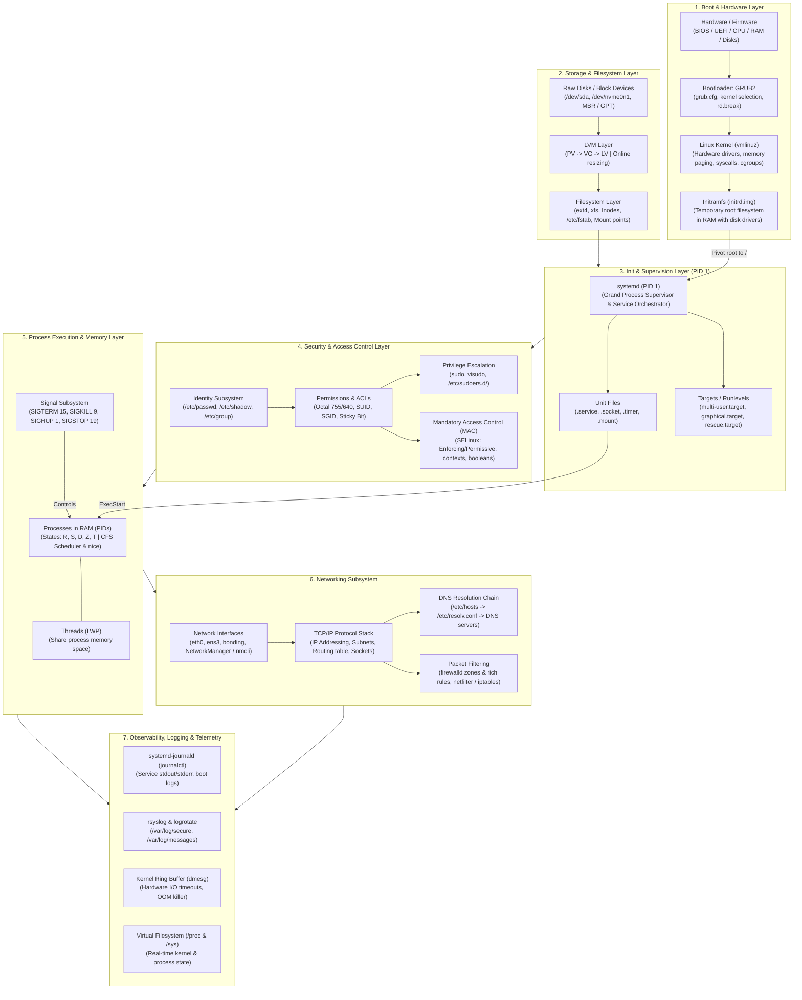

# 🗺️ Complete Linux Master Architecture & SRE Incident Map

> 🤖 **Note:** *This document is AI-generated as an overarching reference and architectural blueprint*

---

## 1. The Complete Linux Operating System Stack (End-to-End)



---

## 2. Cross-Subsystem Incident Triage Matrix

When a production incident strikes, use this system-level guide to pinpoint **which subsystem failed** and **where to look**:

| Failure Category | Real-World Symptoms | Root Cause Behind the Scenes | Primary Diagnostic Commands | Primary Log / Config Files |
| :--- | :--- | :--- | :--- | :--- |
| **Boot Failure** | Server hangs during boot; drops into Emergency Mode shell. | Corrupted `/etc/fstab` (typo or missing UUID), or corrupted Initramfs. | `journalctl -xb`<br>`systemctl default` | `/etc/fstab`<br>`/boot/grub2/grub.cfg`<br>`/etc/default/grub` |
| **Forgotten Root Password** | Locked out of root; sudoers access lost. | Administrator credentials lost or compromised. | Reboot into GRUB2 → append `rd.break` to kernel line → remount `/sysroot` as `rw` → `chroot /sysroot` → `passwd` → `touch /.autorelabel`. | Initramfs environment |
| **Storage / Disk Full** | Apps crash with *"No space left on device"*; database refuses writes. | **Case A:** Disk blocks full (large logs).<br>**Case B:** Inode table exhausted (too many tiny files).<br>**Case C:** Deleted files still held open by running processes. | `df -h` (blocks)<br>`df -i` (inodes)<br>`lsof +L1` (deleted files held by PIDs)<br>`find / -type f -size +200M` | `/var/log/`<br>`/tmp`<br>`/var/lib/` |
| **I/O Hang / Uninterruptible Sleep** | Load Average is high (e.g. 40), but CPU utilization is only 2-5%. Apps time out. | Processes stuck in **State `D`** waiting for unresponsive storage, dead SAN volume, or hung NFS mount. | `ps -eo pid,stat,wchan,cmd \| grep ' D '`<br>`cat /proc/<PID>/wchan`<br>`cat /proc/<PID>/stack` | `dmesg -T \| grep -iE 'nfs\|error\|scsi'` |
| **Service Crash Loop** | `systemctl status` shows `failed (Result: start-limit-hit)` or `code=exited, status=203/EXEC`. | ExecStart path wrong, binary missing `+x`, or app crashing repeatedly exceeding `StartLimitBurst`. | `journalctl -u <svc> -xe`<br>`systemctl reset-failed <svc>`<br>`systemctl daemon-reload` | `/etc/systemd/system/<svc>.service` |
| **Process Exhaustion / Fork Bomb** | Cannot run commands; bash errors: *"fork: retry: Resource temporarily unavailable"*. | System reached `pid_max` or user reached `ulimit -u` due to runaway scripts or leaked zombies. | `ps -e \| wc -l`<br>`cat /proc/sys/kernel/pid_max`<br>`ulimit -u` | `/etc/security/limits.conf`<br>`/proc/sys/kernel/pid_max` |
| **Network Blackout** | Server cannot reach gateway or external APIs; SSH connects very slowly. | Network interface DOWN, missing default gateway, or MTU mismatch. | `ip addr show`<br>`ip route show`<br>`ping -c 3 <gateway>`<br>`nmcli device status` | `/etc/NetworkManager/`<br>`/etc/sysconfig/network-scripts/` |
| **DNS Resolution Failure** | *"Could not resolve host"*; curl/APIs fail by domain name but work by IP address. | `/etc/resolv.conf` empty/misconfigured, nameserver unreachable, or search domain broken. | `dig +trace api.github.com`<br>`nslookup google.com`<br>`cat /etc/resolv.conf` | `/etc/resolv.conf`<br>`/etc/hosts`<br>`/etc/nsswitch.conf` |
| **Firewall Dropping Traffic** | App is running on port 8080 (`ss -tulnp` shows LISTEN), but external clients get *"Connection timed out"*. | Port is blocked by `firewalld` or iptables rules. | `firewall-cmd --list-all`<br>`firewall-cmd --add-port=8080/tcp --permanent`<br>`firewall-cmd --reload` | `/etc/firewalld/zones/` |
| **SELinux Denials (AVC)** | App fails with *"Permission Denied"* even though standard permissions are `777` (`rwxrwxrwx`). | SELinux label on file/port doesn't match service domain policy. | `sestatus`<br>`ls -Z /path/to/file`<br>`ausearch -m avc -ts recent`<br>`audit2why` | `/var/log/audit/audit.log`<br>`/etc/selinux/config` |
| **Sudo Misconfiguration** | Sudo fails with *"no valid sudoers sources found"* or rules in drop-in are ignored. | Filename has dot (`.conf`), permissions not `0440`, or syntax error in `/etc/sudoers.d/`. | `visudo -c` (check syntax)<br>`ls -l /etc/sudoers.d/`<br>`chmod 0440 /etc/sudoers.d/<file>` | `/etc/sudoers`<br>`/etc/sudoers.d/` |
| **Out-Of-Memory (OOM) Kill** | Application suddenly terminates without warning or exit code. | Linux kernel ran out of physical RAM + Swap and invoked the OOM Killer to save the OS. | `dmesg -T \| grep -i -E 'killed process\|oom'`<br>`journalctl -k \| grep -i oom`<br>`free -h` | `/var/log/messages`<br>`dmesg` buffer |

---

## 3. The Enterprise SRE 6-Pillar Diagnostic Toolchain

Whenever logging into an unknown or degraded Linux machine, run these commands in order:

```bash
# 1. System Load & Uptime (Is it CPU-bound or I/O-bound?)
uptime
top -b -n 1 | head -n 20

# 2. Memory & Swap Pressure (Are we close to an OOM kill?)
free -h
vmstat 1 5

# 3. Storage & Inode Capacity (Is disk space or inode count full?)
df -h
df -i

# 4. Kernel & Hardware Health (Are there disk timeouts or crashes?)
dmesg -T | tail -50

# 5. Network Sockets & Port Listeners (Is the service actually listening?)
ss -tulnp
ip route

# 6. Service & Application Logs (What did the application say before dying?)
journalctl -p err -b
```

---
