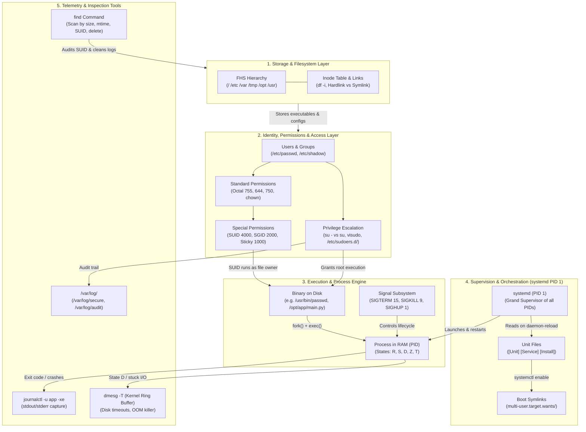

# 🗺️ Master Linux Systems Map & Incident Triage Guide

> 🤖 **Note:** *This document is AI-generated as an overarching reference and architectural blueprint.*

This map visually shows how storage, files, permissions, identity, processes, and `systemd` form a single interconnected machine—and exactly where to look when production breaks.

---

## 1. The Master Systems Flowchart



---

## 2. How the Topics Connect (The Chain of Execution)

```
[DISK & FHS]
/opt/myapp/main.py (Stored on filesystem block, indexed by Inode)
     │
     ▼
[PERMISSIONS & IDENTITY]
Owned by user 'appuser' (Mode: 640). Executed by SUID binary /usr/bin/python3
     │
     ▼
[systemd SUPERVISION]
systemd (PID 1) reads /etc/systemd/system/myapp.service:
- [Unit] waits for network.target
- [Service] switches to User=appuser, launches ExecStart
- [Install] symlinked into multi-user.target.wants/
     │
     ▼
[PROCESS IN RAM]
Kernel assigns PID 4510:
- Runs in State 'R' or 'S'
- If it calls slow storage -> Enters State 'D' (Loads Average rises!)
- If child terminates without parent reaping -> Enters State 'Z' (Zombie)
- Controlled via Signals: SIGTERM (15), SIGHUP (1), SIGKILL (9)
     │
     ▼
[LOGGING & TRIAGE]
All console prints caught by systemd-journald (journalctl)
System audit events recorded in /var/log/secure
Disks searched and monitored using 'find'
```

---

## 3. Production Incident Decision Matrix: "What broke & Where to look"

| What is Breaking / Alert | What is Happening Behind the Scenes | Exact Place to Look | Primary Tool / Command |
| :--- | :--- | :--- | :--- |
| **"Service failed with status=203/EXEC"** | `systemd` tried to start the process, but the path in `ExecStart` doesn't exist or lacks `+x` execute permission. | Unit file & binary path | `ls -l <ExecStart_path>`<br>`journalctl -u <svc> -xe` |
| **"Service won't start: start-limit-hit"** | App crashed too many times in a short window. `systemd` locked it to prevent CPU exhaustion. | Unit crash history | `systemctl reset-failed <svc>`<br>`systemctl start <svc>` |
| **"Service works manually, but fails at boot"** | Missing `After=network.target` or `Requires=`. App booted before network or database was ready. | `[Unit]` section | `vim /etc/systemd/system/<svc>.service`<br>`systemctl daemon-reload` |
| **"High Load Average, but CPU is 5%"** | Processes are stuck in **State `D`** (Uninterruptible sleep) waiting for hung disk or NFS storage. | Kernel Wait Channel & Storage | `ps -eo pid,stat,wchan,cmd`<br>`cat /proc/<PID>/wchan`<br>`dmesg -T \| grep -iE 'error\|nfs'` |
| **"Zombie process won't die with kill -9"** | Process is already dead (0 CPU, 0 RAM). Only an unread table entry remains. | Parent process (PPID) | `ps -o pid,ppid,state,cmd \| grep defunct`<br>`kill -CHLD <PPID>` (or kill PPID) |
| **"Disk full: No space left on device"** | Either disk blocks are full (large logs) OR Inodes are exhausted (millions of tiny files). | Filesystem & Inode tables | `df -h` (check block space)<br>`df -i` (check Inode space!)<br>`find /var -type f -size +100M` |
| **"Permission denied inside user's own home"** | An admin ran `su` (no dash) and installed a tool (like `pip`/`npm`), creating root-owned files in `$HOME`. | Environment pollution in `$HOME` | `ls -la /home/<user>/`<br>`chown -R <user>:<user> /home/<user>/` |
| **"sudo: /etc/sudoers.d/file is ignored"** | Filename has a dot (`.conf`), file permissions are not `0440`, or syntax error. | Drop-in sudoers rules | `visudo -f /etc/sudoers.d/<file>`<br>`chmod 0440 /etc/sudoers.d/<file>` |
| **"Users in shared directory deleting others' work"** | The **Sticky Bit (`+t` / `1000`)** was accidentally removed from the shared world-writable directory. | Directory special permissions | `ls -ld /shared`<br>`chmod +t /shared` (or `chmod 1777 /shared`) |
| **"New files in team directory have wrong group"** | Missing **SGID (`g+s` / `2000`)** on the directory. New files are using user's primary group instead of team group. | Directory group inheritance | `chmod g+s /data/project`<br>`chmod 2775 /data/project` |

---

## 4. The 5-Step Rapid Triage Workflow for Any Incident

When any production server alert fires, follow this exact sequence:

```
Step 1: Check System Pressure
        └── uptime (Load Average)  ->  Is Load > # of CPU cores?
        └── free -m (Memory/Swap)   ->  Is RAM exhausted?
        └── df -h && df -i (Storage) -> Are blocks or inodes 100% full?

Step 2: Check Service Health
        └── systemctl status <service>
        └── Is it failed? Look for exit-code, start-limit-hit, 203/EXEC.

Step 3: Read the Logs
        └── journalctl -u <service> -xe (Last error stack trace)
        └── dmesg -T | tail -50 (Kernel warnings, OOM kills, disk failures)
        └── /var/log/secure (Failed logins, sudo rejections)

Step 4: Check Running Processes
        └── ps aux | grep <service> (State: R, S, D, Z?)
        └── top (CPU or I/O bottleneck?)

Step 5: Inspect Files & Permissions
        └── find /path -type f -mmin -30 (What changed recently?)
        └── ls -ld (Permissions, owner, group, SUID/SGID/Sticky bits)
```
